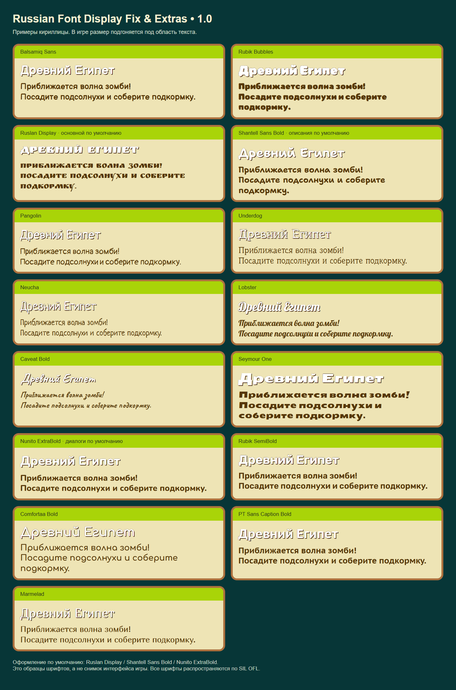

# Russian Font Display Fix & Extras

Version 1.0.1 reduces objective text in both the pre-level and pause windows. Text wrapping and the global size setting remain available.

Version **1.0.1**. A GP-Next JavaScript mod for PvZ2 Gardendless that improves Russian text rendering and interface layout, adds font customization, and provides optional gameplay extras.

[Русское описание](README.ru.md) · [License](LICENSE) · [Font licenses and sources](THIRD_PARTY_NOTICES.md) · [Publishing guide](PUBLISHING.md)

## Screenshots

Click a thumbnail, then use **Previous / Next** to browse all 20 screenshots.

[Open the interactive gallery →](https://d1g1tal-geek.github.io/gardendless-russian-font-fix-extras/) · [All screenshots / Все скриншоты](SCREENSHOTS.md)

<table>
  <tr>
    <td align="center" width="33%"><a href="docs/gallery/01-bonus-reward.md"></a><br><sub>01. Bonus reward</sub></td>
    <td align="center" width="33%"><a href="docs/gallery/02-world-map.md"></a><br><sub>02. Ancient Egypt world map</sub></td>
    <td align="center" width="33%"><a href="docs/gallery/03-plant-shop.md"></a><br><sub>03. Plant shop</sub></td>
  </tr>
  <tr>
    <td align="center" width="33%"><a href="docs/gallery/04-coin-shop.md"></a><br><sub>04. Coin shop</sub></td>
    <td align="center" width="33%"><a href="docs/gallery/05-standard-garden.md"></a><br><sub>05. Standard Zen Garden</sub></td>
    <td align="center" width="33%"><a href="docs/gallery/06-water-garden.md"></a><br><sub>06. Water Zen Garden</sub></td>
  </tr>
  <tr>
    <td align="center" width="33%"><a href="docs/gallery/07-plant-decoding.md"></a><br><sub>07. Plant decoding minigame</sub></td>
    <td align="center" width="33%"><a href="docs/gallery/08-game-settings.md"></a><br><sub>08. Game settings</sub></td>
    <td align="center" width="33%"><a href="docs/gallery/09-more-settings.md"></a><br><sub>09. Additional game settings</sub></td>
  </tr>
  <tr>
    <td align="center" width="33%"><a href="docs/gallery/10-world-chooser.md"></a><br><sub>10. World selection</sub></td>
    <td align="center" width="33%"><a href="docs/gallery/11-mod-manager.md"></a><br><sub>11. GP-Next mod manager</sub></td>
    <td align="center" width="33%"><a href="docs/gallery/12-font-settings.md"></a><br><sub>12. Font settings</sub></td>
  </tr>
  <tr>
    <td align="center" width="33%"><a href="docs/gallery/13-live-font-preview.md"></a><br><sub>13. Live font previews and optional fixes</sub></td>
    <td align="center" width="33%"><a href="docs/gallery/14-game-hint.md"></a><br><sub>14. In-game hint</sub></td>
    <td align="center" width="33%"><a href="docs/gallery/15-almanac.md"></a><br><sub>15. Plant Almanac</sub></td>
  </tr>
  <tr>
    <td align="center" width="33%"><a href="docs/gallery/16-upgrade-controls.md"></a><br><sub>16. Upgrade controls</sub></td>
    <td align="center" width="33%"><a href="docs/gallery/17-plant-medals.md"></a><br><sub>17. Plant medals and families</sub></td>
    <td align="center" width="33%"><a href="docs/gallery/18-world-information.md"></a><br><sub>18. World information</sub></td>
  </tr>
  <tr>
    <td align="center" width="33%"><a href="docs/gallery/19-battle-hud.md"></a><br><sub>19. Battle interface</sub></td>
    <td align="center" width="33%"><a href="docs/gallery/20-dialogue.md"></a><br><sub>20. Dialogue</sub></td>
  </tr>
</table>

## AI provenance and support

**Project publisher's declaration: 100% of the mod code and project documentation was generated using AI OpenAI GPT 6.1.** Bundled third-party fonts are not AI-generated; their authors and licenses are listed separately.

The developer/publisher has **no obligation to respond to bug reports, provide support, fix bugs, improve, maintain, update, or adapt this mod**. It is provided as-is, without a warranty. Anyone may fork and maintain their own version under the included licenses.

## Requirements and installation

The implementation targets **Gardendless 0.15.0, GP-Next 1.5.4, and Cocos 3.8.4**. The manifest declares GP-Next `>=1.5.4 <2.0.0`, but later versions are not guaranteed compatible. Enable GP-Next's `experimental.jsModding` feature. A separate enabled Russian translation pack is required for Russian game text; this mod does not contain a complete translation.

1. Download **Russian_Font_Display_Fix_Extras_1.0.1.zip** from the release assets.
2. Return to the main menu and open **F9 → Mods → Import ZIP**. Import the ZIP directly.
3. Enable the mod. If GP-Next asks to trust the code, review the package and confirm that prompt yourself.
4. Save the configuration, fully close the game, and launch it again. Restarting a level is insufficient.

Use the installable release ZIP for GP-Next. GitHub's automatic **Source code** archives contain the development project and are not the installation ZIP. To uninstall, disable the mod, save the configuration, and fully restart the game.

For settings, open **F9 → Mods → State and controls → Русский шрифт и размеры**. The custom controls are labelled in Russian. The standard F9 interface is kept in English.

## Defaults

| Setting | First-install default |
| --- | --- |
| Startup game language | Russian |
| Main font | Ruslan Display |
| Descriptions and tips | Shantell Sans Bold |
| Dialogue | Nunito ExtraBold |
| Text size | 68% |
| Cheat mode | Allow cheats — «Разрешить читы» |
| Game fixes | All checkboxes off; currently the planning-mode copy fix |
| Price editor | Collapsed |

Manually saved choices survive updates. “Allow cheats” permits the game's own cheat switch; it does not turn cheats on automatically. Enable cheats separately in the game's settings if wanted.

## Features

### Fonts, text sizing, and previews

- Choose fonts independently for main text, descriptions/tips, and dialogue. Descriptions and dialogue can also follow the main font.
- Fifteen font families are included: Balsamiq Sans, Rubik Bubbles, Ruslan Display, Shantell Sans Bold, Pangolin, Underdog, Neucha, Lobster, Caveat Bold, Seymour One, Nunito ExtraBold, Rubik SemiBold, Comfortaa Bold, PT Sans Caption Bold, and Marmelad. Balsamiq includes separate regular and bold files.
- Adjust text size from **50% to 80%**. Settings apply to supported live labels and dynamically created labels; fitting limits overly large text to its available area.
- Text wrapping, line height, letter spacing, outlines, and reserved areas for icons and neighbouring values are adjusted to improve legibility.
- The settings panel contains **live samples of the selected fonts**, rendered by the game engine with outlines. It previews headings, prose, and dialogue.
- Restore recommended fonts and the standard text size with separate reset buttons. The buttons have spacing above them.
- Fonts load before rendering. If font loading fails or times out, the mod falls back to Arial and reports the failure in the log.



### Interface and hints

- Reflows Russian titles, world and level names, buttons, warnings, loss messages, reward captions, settings labels, and dialogue to fit their containers.
- Improves Almanac descriptions, dialogue-style entries, stat names/values, family and medal captions, and upgrade controls.
- Enlarges the settings-window title and preserves the bonus card's full-sized **Enabled** button.
- Wraps long level objectives using the description font, including objectives added dynamically and shown in the pause window.
- Makes the remaining-plants counter readable inside its native panel, after the plant icon.
- Renders global game hints into a dedicated measured text texture with padding for glyphs and outlines. The hint layout reserves illustration space and avoids inherited scroll masks, overlapping panels, and bottom event controls. Hint timing and dismissal remain native.
- Improves ticket-expiry and Piñata Party countdown layouts, shop tabs, scrolling cards, close controls, purchase-price labels, Arcade reward rows, fan-made level captions, and the Almanac medal/exit overlap.
- Keeps native numeric currency fonts and normal gameplay camera/input behaviour. Text baked into images cannot be changed by font settings.

### Zen Garden

- Fits and centres planting cells using their actual positions in the standard, mushroom, night, and water gardens.
- Applies the **same transform to the background and planting cells**, so pots stay on their tables and water slots stay attached to the scene.
- Attempts to fill the viewport while keeping all planting cells visible and clear of native controls. Decorative edges may be cropped. When uniform fitting cannot cover the wide water garden, the entire garden can be fitted along both axes together.
- Preserves native control positions, improves the quick-shovel caption, and raises the lower currency/sprout counter group slightly.

### Startup language

Under **Оформление → Язык запуска по умолчанию**, choose **Русский** or **English**. The selection is saved separately and applies on the **next full game launch**. Changing it does not restart the current level.

Russian selection waits briefly for a translation pack to register. If Russian is unavailable, the current language is retained and a warning is logged. English selection uses the native English language. Only the language field is updated in the game's settings; unrelated options are preserved. The initial menu can be refreshed once to apply the selected language; active levels are never restarted by this feature.

### Cheats and coin-priced power-ups

Three modes are available:

| Mode | Behaviour |
| --- | --- |
| No cheats — «Без читов» | Disables and blocks free cheats. |
| Allow cheats — «Разрешить читы» | Allows the native cheat setting; cheats must be enabled separately. |
| For coins — «За монеты» | Blocks free cheats, including free sun, and enables coin-priced power-ups and purchased Plant Food. |

Changing modes cancels the selected power-up and switches free cheats off. In coin mode, open **Настроить стоимость усилений** to edit prices; the editor stays collapsed otherwise. **Вернуть цены по умолчанию** restores all six prices.

| Purchase | Default coin price |
| --- | ---: |
| Fire | 1200 |
| Snowballs | 1150 |
| Toss | 950 |
| Lightning | 800 |
| Cherry explosion | 1500 |
| One Plant Food | 1000 |

Prices must be whole numbers from **1 to 2147483647**. Invalid input preserves the last valid price.

- Selecting a power-up and cancelling before activation costs nothing. Payment happens once when the effect starts; the cherry effect is charged before the selected-cell explosion.
- Purchases show the game's existing **coin and gem panel**, refresh its normal hide timer, animate the remaining balance, and use native sound feedback. Repeated purchases refresh that timer.
- Insufficient funds use native failure feedback; unaffordable buttons are dimmed. Duplicate starts and invalid or negative balances are rejected. Saving must succeed before a paid effect starts; failed payment restores the wallet snapshot.
- Successfully started effects are not refunded by cancelling afterward.
- Power-up buttons gain hover and press feedback. Native level restrictions and mandatory tutorial power-ups are respected. Profile changes cancel a pending selection.

### Optional planning-mode copy fix

Under **Исправления игры**, enable **Убирать копии от начального буста до старта раунда**. It is **off by default**.

In Last Stand preparation, an initial garden/gem boost follows the game's normal consumption rules, while extra plant copies from that initial boost are suppressed. This prevents digging up those copies for additional full-price sun refunds during planning. The base game's own boost activation rules remain intact; the fix does not force a boost to activate.

The restriction ends **as soon as the round is started**, including the Ready/Set interval. Later initial boosts and ordinary leaf-based Plant Food retain normal copy behaviour. Imitater transformations and delayed spawns are covered. Other modes are unaffected. Disabling the option restores normal copy behaviour.

### Local state and cleanup

The mod stores its preferences locally and uses the game's normal wallet save during paid purchases. It requires no external accounts, API keys, or telemetry service. Scene changes and disposal restore owned layouts and hooks, remove temporary hint/preview textures, and release loaded font faces.

## Full source, building, and reuse

The repository includes **all mod source**, the bundled entry, build script, standalone tests, font files, and their licenses. There is no hidden source or required private service.

The mod code, build script, tests, and project documentation use the **[MIT License](LICENSE)**. You may download, study, modify, fork, redistribute, sublicense, and use them for personal or commercial purposes, retaining the MIT notice. Bundled fonts remain under **SIL OFL 1.1**; retain their notices and respect their font-specific terms. Game and engine files are not included or licensed by this project.

Build with Python **3.10+**, using only its standard library:

```sh
python build.py
```

This refreshes `scripts/main.mjs` and creates the installable ZIP, the complete source ZIP, and checksums in `dist/`. Identical inputs produce identical archive bytes with the same Python/zlib environment. Run the standalone preference/language tests with Node.js **20+**:

```sh
node --test tests/preferences.test.mjs
```

| File | Purpose |
| --- | --- |
| `src/main.mjs` | Font loading, text fitting, hint rendering, startup language, settings panel |
| `src/layout-ui.mjs` | Garden, shop, and additional interface layout |
| `src/font-preview.mjs` | Live engine-rendered font samples |
| `src/paid-powerups.mjs` | Cheat modes, prices, wallet handling, button feedback |
| `src/planning-boost.mjs` | Optional preparation-only copy suppression |
| `scripts/main.mjs` | Generated self-contained GP-Next entry |
| `assets/fonts/` | Fonts, width metrics, and original SIL OFL notices |

## Compatibility limits

Automated checks cover startup, language selection, preference defaults, purchases, scene changes, native interface fixtures, fonts, and hint rendering in an isolated Cocos environment. This public package has not undergone a full playthrough in every game mode. Changes to game internals or other mods may affect compatibility; visual clipping in every live scene is not guaranteed resolved. This release does not promise bug-free behaviour or future maintenance.
