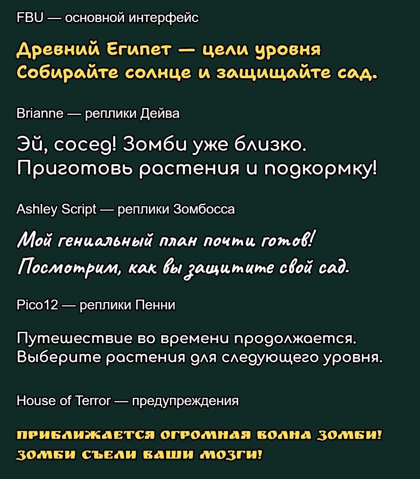

# Russian Font Display Fix & Extras

Version **1.0.3**. A GP-Next JavaScript mod for PvZ2 Gardendless: readable Russian fonts, improved interface spacing, and optional gameplay extras.

Version 1.0.3 replaces the withdrawn 1.0.2: English GP-Next panel, English loading before translation registration, a master auto-collection switch that clears its children, and Piñata Party hidden throughout menu-transition tips. All accumulated font, interface and optional gameplay changes remain. [All changes](CHANGELOG.md).

[Download 1.0.3](https://github.com/D1G1TaL-GeeK/gardendless-russian-font-fix-extras/releases/tag/v1.0.3) · [Русское описание](README.ru.md) · [License](LICENSE) · [Font licenses](THIRD_PARTY_NOTICES.md)

## Screenshots

The gallery contains 20 real screenshots captured in earlier versions with user-selected settings; the new controls are described below.

Open the gallery below, then use **Previous / Next** to browse the earlier screenshots.

[Open the interactive gallery →](https://d1g1tal-geek.github.io/gardendless-russian-font-fix-extras/) · [All screenshots / Все скриншоты](https://github.com/D1G1TaL-GeeK/gardendless-russian-font-fix-extras/blob/main/SCREENSHOTS.md)

## AI provenance and support

**Project publisher's declaration: 100% of the mod code and project documentation was generated using AI OpenAI GPT 6.1.** Bundled third-party fonts are not AI-generated; their authors and licenses are listed separately.

The developer/publisher has **no obligation to respond to bug reports, provide support, fix bugs, improve, maintain, update, or adapt this mod**. It is provided as-is, without a warranty. Anyone may fork and maintain their own version under the included licenses.

## Requirements and installation

Targets **Gardendless 0.15.0 / Cocos 3.8.4**. Isolated checks cover **GP-Next 1.5.4 and 1.5.5**. The manifest accepts `>=1.5.4 <2.0.0`; other versions have not been verified. Players need no Python, Node.js, compiler, account, or paid service.

A separate enabled **Russian translation pack** is required for Russian game text. This mod fixes fonts/layout and does not provide a complete translation. It has no mandatory dependency on one particular translation-pack ID.

1. Download **[Russian_Font_Display_Fix_Extras_1.0.3.zip](https://github.com/D1G1TaL-GeeK/gardendless-russian-font-fix-extras/releases/download/v1.0.3/Russian_Font_Display_Fix_Extras_1.0.3.zip)** from the release assets.
2. Return to the main menu. Open **F9 → Experimental → JS Modding**, enable it, and review/confirm GP-Next's script notice.
3. Open **Mods → Import ZIP**, select the archive directly, and check the displayed name/version. Install and enable your Russian translation pack separately.
4. Enable **Russian Font Display Fix & Extras**. Review the package and confirm its script-trust prompt, including renewed trust if GP-Next asks after an update.
5. Save/apply the mod selection, fully close the game, and launch it again. Restarting only a level is insufficient.
6. In **F9 → Mods**, open the mod's details or **State and controls → Русский шрифт и размеры**. Controls are labelled in Russian; GP-Next's interface language is independent.

**Updating:** import the new ZIP with the same mod ID. Existing valid font, size, language, price, collection, and speed choices remain saved. Use **Вернуть рекомендуемое оформление** to apply the new recommended font preset to an existing installation. Avoid keeping two versions enabled.

The **_Source.zip** asset and GitHub's automatic **Source code** archives are for development. Install the ZIP without `_Source`. To disable/uninstall, use the mod manager, save/apply, and fully restart.

### Startup recovery: INSTALL_CORRUPT

GP-Next verifies installed package bytes against their recorded digest before loading the engine. Editing files inside `gp-next/installed/` breaks that verification and can produce `INSTALL_CORRUPT` plus `STARTUP_FAILED` at `beforeEngineImport`, even with an empty `modIssues` list. Local development copies edited in place must be replaced through ZIP/folder import; do not edit installation records or bypass validation.

Use GP-Next's recovery screen and its available mod-manager/import action to reimport an unchanged package or this release. If the manager cannot open, follow **[the official recovery guide](https://pvzge.com/en/guide/mod/gp-next-recovery)** and its suggested action, then reimport through the manager. Preserve saves and backups. This release supplies a valid importable package; it cannot repair a corrupt installed cache before its own script loads. Other causes of startup failure still need their full error details.

## Defaults

| Setting | First-install default |
| --- | --- |
| Startup game language | Russian |
| FBU — main interface | Shantell Sans Bold |
| Brianne — Dave dialogue | Comfortaa Bold |
| Ashley Script — Zomboss dialogue | Caveat Bold |
| Pico12 — Penny dialogue | Comfortaa Bold |
| House of Terror — warnings and defeat | Ruslan Display |
| Text size | 68% |
| Cheat mode | Allow cheats — «Разрешить читы» |
| Other-drop, sun, and plant-food auto-collection | All three checkboxes off |
| Game improvements — «Улучшения игры» | All checkboxes off: planning copy fix and custom fast-forward |
| Custom fast-forward multiplier | 2×; inactive until its checkbox is enabled |
| Price editor and auto-collection group | Collapsed |

These font choices also apply to the recommended-style reset. Manually saved choices survive updates. “Allow cheats” permits the game's own cheat switch; it does not turn cheats on automatically. Enable cheats separately in the game's settings if wanted.

## Features

### Fonts, text sizing, and previews

- Penny dialogue uses Dave's native base size while keeping its own selected font. Ordinary and portrait bubbles retain their native dimensions, and long lines fit within their width and measured glyph height.
- Choose replacements independently for all five original game fonts: **FBU** for interface text, buttons, descriptions, objectives, hints, and counters; **Brianne** for Dave; **Ashley Script** for Zomboss; **Pico12** for Penny; **House of Terror** for combat warnings and defeat. Each selector explains its role.
- Every slot offers all fifteen bundled families. Routing follows the original font asset, including native speaker changes in a shared dialogue bubble. Legacy main-font choices migrate to FBU and House of Terror, and dialogue choices migrate to the three dialogue slots; explicitly saved new choices take priority.
- Fifteen font families are included: Balsamiq Sans, Rubik Bubbles, Ruslan Display, Shantell Sans Bold, Pangolin, Underdog, Neucha, Lobster, Caveat Bold, Seymour One, Nunito ExtraBold, Rubik SemiBold, Comfortaa Bold, PT Sans Caption Bold, and Marmelad. Balsamiq includes separate regular and bold files.
- Adjust text size from **50% to 80%**. Settings apply to supported live labels and dynamically created labels; fitting limits overly large text to its available area.
- Text wrapping, line height, letter spacing, outlines, and reserved areas for icons and neighbouring values are adjusted to improve legibility.
- The settings panel contains **five live font samples**, rendered by the game engine with role captions and outlines. Changing one slot updates its corresponding sample.
- Restore recommended fonts and the standard text size with separate reset buttons. The buttons have spacing above them.
- Fonts load before rendering. If font loading fails or times out, the mod falls back to Arial and reports the failure in the log.



Recommended font preset: Shantell Sans Bold / Comfortaa Bold / Caveat Bold / Comfortaa Bold / Ruslan Display.

### Interface and hints

- Reflows Russian titles, world and level names, buttons, warnings, loss messages, reward captions, settings labels, and dialogue to fit their containers.
- Improves Almanac descriptions, dialogue-style entries, stat names/values, family and medal captions, and upgrade controls.
- Adds upper/paragraph gaps to plant and zombie descriptions; Enabled buttons and descriptions fit inside their upgrade cards. The Plant Medals title stays clear of its frame.
- Fits the player-list title between Fix Player and Close and keeps sold-out shop buttons inside their own cards.
- Separates Plant Decoding legend captions from icons/frame and from one another.
- Enlarges the settings-window title and preserves the bonus card's full-sized **Enabled** button.
- Wraps long level objectives using the selected FBU replacement, including dynamically added objectives and the pause window. Their size stays close to the sound-setting labels and follows the global size preference.
- Makes the remaining-plants counter readable inside its native panel, after the plant icon.
- Renders **LoaderFlower loading tips**, including the family-medal/Mint tip, into a measured texture padded for actual glyph bounds and outlines. The native string, animation-driven visibility, five-second rotation, and loading completion remain intact.
- Handles global **GamingTips** notifications separately: their layout reserves illustration space and avoids inherited scroll masks, overlapping panels, and bottom event controls. Notification timing and dismissal remain native.
- Improves ticket-expiry and Piñata Party countdown layouts, shop tabs, scrolling cards, close controls, purchase-price labels, Arcade reward rows, fan-made level captions, and the Almanac medal/exit overlap.
- Gives the Test Levels title and Play Custom Levels control separate areas. Scrolling the list no longer changes the control caption’s width or wrapping.
- Raises the player-journey introduction above active power-up buttons with a small gap, without accumulating movement on repeated scans.
- Centers the bottom level caption between active power-ups and the native progress panel. Pause/fast-forward controls gain inward edge margins; the shovel and its D hint move slightly left, and the paid plant-food button leaves room for F.
- Enlarges the Arcade daily-earnings caption using up to two lines beside the native gem amount and icon. The caption follows the text-size setting and retains room for the animated reward and launch button.
- Keeps native numeric currency fonts and normal gameplay camera/input behaviour. Text baked into images cannot be changed by font settings.

The Piñata Party card and its buttons are temporarily hidden while a global notification or a loading/menu-transition tip is visible, including its fade-out. The event timer continues to update, and the current native card state returns when the message ends.

### Zen Garden

- Fits and centres planting cells using their actual positions in the standard, mushroom, night, and water gardens.
- Applies the **same transform to the background and planting cells**, so pots stay on their tables and water slots stay attached to the scene.
- Attempts to fill the viewport while keeping all planting cells visible and clear of native controls. Decorative edges may be cropped. When uniform fitting cannot cover the wide water garden, the entire garden can be fitted along both axes together.
- Preserves native control positions, improves the quick-shovel caption, and raises the lower currency/sprout counter group slightly.
- Adds inward margins to currency panels, back/tool controls, and medals, adapting to parent scale without accumulating offsets.

### Startup language

Under **Оформление → Язык запуска по умолчанию**, choose **Русский** or **English**. The selection is saved separately and applies on the **next full game launch**. Changing it does not restart the current level.

The loading scene starts in English while the Russian translation pack registers. Russian selection then uses the registered Russian language index; if Russian is unavailable, English remains active and a warning is logged. GP-Next’s panel is kept in English independently of the selected game language, on both 1.5.4 and 1.5.5. English selection uses the native English language. Only the language field is updated in the game's settings; unrelated options are preserved. The initial menu can be refreshed once to apply the selected language; active levels are never restarted by this feature.

### Cheats and coin-priced power-ups

Three modes are available:

| Mode | Behaviour |
| --- | --- |
| No cheats — «Без читов» | Disables and blocks free cheats. |
| Allow cheats — «Разрешить читы» | Allows the native cheat setting; cheats must be enabled separately. |
| For coins — «За монеты» | Blocks free cheats, including free sun, and enables coin-priced power-ups and purchased Plant Food. |

Changing modes cancels the selected power-up and switches free cheats off. In coin mode, open **Настроить стоимость усилений** directly below the cheat-mode selector to edit prices; the editor stays collapsed otherwise. **Вернуть цены по умолчанию** restores all six prices.

| Purchase | Default coin price |
| --- | ---: |
| Fire | 1200 |
| Snowballs | 1150 |
| Toss | 950 |
| Lightning | 800 |
| Cherry explosion | 1500 |
| One Plant Food | 1000 |

Prices must be whole numbers from **1 to 2147483647**. Invalid input preserves the last valid price.

- Selecting a power-up and cancelling before activation costs nothing. Payment happens once when the effect starts; the cherry effect is charged before the selected-cell explosion.
- Purchases show the game's existing **coin and gem panel**, refresh its normal hide timer, animate the remaining balance, and use native sound feedback. Repeated purchases refresh that timer.
- Insufficient funds use native failure feedback; unaffordable buttons are dimmed. Duplicate starts and invalid or negative balances are rejected. Saving must succeed before a paid effect starts; failed payment restores the wallet snapshot.
- Successfully started effects are not refunded by cancelling afterward.
- Power-up buttons gain hover and press feedback. Native level restrictions and mandatory tutorial power-ups are respected. Profile changes cancel a pending selection.

### Auto-collection

Under **Читы и усиления**, enable **Настроить автоподбор предметов** to reveal three independent, saved checkboxes, all **off by default**. Turning this main checkbox off immediately clears all three choices and stops mod auto-collection. Re-enabling opens an empty submenu; choose the desired items again. The main checkbox and item choices are saved together:

- **Автоподбор прочего дропа**: coins, gems, sprouts, and tickets, including garden coins and gems. Sun and plant food are excluded.
- **Автоподбор солнца**: ordinary sun only. Dangerous sun bombs are not activated.
- **Автоподбор листиков подкормки**: plant-food leaves only. A full bank waits for an available slot; collected plant food stays in the bank.

Changes apply during play through native collection methods, retaining rewards, sounds, animation, tutorial callbacks, and collection restrictions. Pauses and level transitions are respected. Existing level-specific auto-collection stays intact. These options work independently of the power-up payment mode.

### Optional planning-mode copy fix

Under **Улучшения игры**, enable **Убирать копии от начального буста до старта раунда**. It is **off by default**.

In Last Stand preparation, an initial garden/gem boost follows the game's normal consumption rules, while extra plant copies from that initial boost are suppressed. This prevents digging up those copies for additional full-price sun refunds during planning. The base game's own boost activation rules remain intact; the fix does not force a boost to activate.

The restriction ends **as soon as the round is started**, including the Ready/Set interval. Later initial boosts and ordinary leaf-based Plant Food retain normal copy behaviour. Imitater transformations and delayed spawns are covered. Other modes are unaffected. Disabling the option restores normal copy behaviour.

### Custom fast-forward

Under **Улучшения игры**, enable **Изменить стандартный множитель ускорения**. It is **off by default**. A slider and numeric input share a saved value from **1× to 10× in 0.1 increments**.

- Editing during native fast-forward applies the new value immediately and retains it on later frames.
- During normal play, the new value takes effect when fast-forward is next enabled.
- Editing while paused cannot resume the game; the selected value is applied after resuming.
- Disabling the checkbox during a level restores the game's own multiplier.
- The native button sound, pressed artwork, automatic danger response, loss, restart, and exit behavior are retained.
- Invalid or out-of-range input keeps the last valid value; additional decimal places round to the nearest tenth.
- The input accepts both `2.5` and `2,5`. Enter commits the value. Russian-layout punctuation keys and the keypad decimal key are supported.
- The sandbox's existing preparation multiplier remains separate: this option replaces only the native fast-forward factor.

### Settings scroll position

Changing a mod setting, confirming a value with Enter, or using a reset button retains the menu's scroll position while GP-Next rebuilds the controls and font preview. A deliberate scroll or click cancels pending restoration. If hiding a group reduces the available scroll range, the position is limited to the new end of the menu.

### Local state and cleanup

The mod stores its preferences locally and uses the game's normal wallet save during paid purchases. It requires no external accounts, API keys, or telemetry service. Scene changes and disposal restore owned layouts and hooks, remove temporary hint/preview textures, and release loaded font faces.

## Full source, building, and reuse

The repository includes **all mod source**, the bundled entry, build script, standalone tests, font files, and their licenses. There is no hidden source or required private service.

The mod code, build script, tests, and project documentation use the **[MIT License](LICENSE)**. You may download, study, modify, fork, redistribute, sublicense, and use them for personal or commercial purposes, retaining the MIT notice. Bundled fonts remain under **SIL OFL 1.1**; retain their notices and respect their font-specific terms. Game and engine files are not included or licensed by this project.

Build with Python **3.10+**, using only its standard library:

```sh
python build.py
```

This refreshes `scripts/main.mjs` and creates the installable ZIP, the complete source ZIP, and checksums in `dist/`. Identical inputs produce identical archive bytes with the same Python/zlib environment. Run the standalone preference/language tests with Node.js **20+**:

```sh
node --test tests/*.test.mjs
```

| File | Purpose |
| --- | --- |
| `src/main.mjs` | Font loading, text fitting, hint rendering, startup language, settings panel |
| `src/layout-ui.mjs` | Garden, shop, and additional interface layout |
| `src/font-slots.mjs` | Five native font identities, saved replacements, and legacy preference migration |
| `src/font-preview.mjs` | Five live engine-rendered font samples |
| `src/paid-powerups.mjs` | Cheat modes, prices, wallet handling, button feedback |
| `src/planning-boost.mjs` | Optional preparation-only copy suppression |
| `src/game-speed.mjs` | Optional live fast-forward multiplier, slider, and numeric input |
| `src/settings-view.mjs` | Scroll preservation and nested auto-collection styling |
| `src/auto-collect.mjs` | Independent native pickup collection |
| `src/tip-party.mjs` | Piñata Party visibility during notifications |
| `scripts/main.mjs` | Generated self-contained GP-Next entry |
| `assets/fonts/` | Fonts, width metrics, and original SIL OFL notices |

## Compatibility limits

Automated checks cover startup, language selection, preference defaults, purchases, scene changes, native interface fixtures, fonts, and hint rendering in an isolated Cocos environment. This public package has not undergone a full playthrough in every game mode. Changes to game internals or other mods may affect compatibility; visual clipping in every live scene is not guaranteed resolved. This release does not promise bug-free behaviour or future maintenance.
